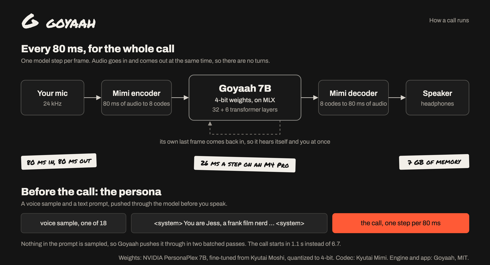

<p align="center"></p>
<h1 align="center">Goyaah</h1>
<p align="center">An open-source full-duplex speech-to-speech voice model on your Mac.<br>4-bit, 7 GB of memory, no cloud.</p>

Goyaah is a full-duplex speech-to-speech voice model that runs on your Mac: it listens and
talks at the same time. You can interrupt it, it backchannels ("mm-hm", "got it"), and it
never waits for a "turn". There is no speech-to-text step in between. Everything runs
locally on Apple Silicon with [MLX](https://github.com/ml-explore/mlx); no GPU server, no
API key, nothing leaves the machine.

## The model

| | |
|---|---|
| Weights | [rawheel/goyaah-7b-mlx-4bit](https://huggingface.co/rawheel/goyaah-7b-mlx-4bit) on Hugging Face: 5.2 GB, 4-bit, group size 64, safetensors |
| Size | 7B parameters, about 7 GB of memory while running |
| Speed | 26 ms per 80 ms frame on an M4 Pro, so 3x faster than real time |
| Audio | 24 kHz in and out, through the Mimi codec at 12.5 Hz, 8 codebooks |
| Context | 3000 frames (4 minutes of call) in a fixed ring buffer, so memory never grows |
| Voices | 18, picked with a short voice sample; the persona is a text prompt |
| Base | [nvidia/personaplex-7b-v1](https://huggingface.co/nvidia/personaplex-7b-v1), NVIDIA's fine-tune of Kyutai's Moshi; quantized, not retrained |
| License | NVIDIA Open Model License for the weights, MIT for the code |

An 8-bit build is one command away if your Mac has the memory (see below). The 4-bit
weights are checked against the original frame by frame; see `goyaah-bench verify-prefill`.

## Setup

Apple Silicon Mac with 16 GB of memory or more, Python 3.12 with
[uv](https://docs.astral.sh/uv/), and 6 GB of free disk.

```bash
git clone https://github.com/rawheel/goyaah
cd goyaah
uv venv --python 3.12 && uv pip install -e .
.venv/bin/goyaah-download   # the 4-bit model, Mimi, tokenizer and voices, 5.6 GB
.venv/bin/goyaah-serve      # then open http://localhost:8998
```

Put on headphones and press **Start call**.

`goyaah-download` fetches the model from Hugging Face into `~/.cache/goyaah`. No account
is needed.

<details>
<summary>Convert it yourself instead (needed for 8-bit)</summary>

Needs a Hugging Face account that has accepted the
[PersonaPlex license](https://huggingface.co/nvidia/personaplex-7b-v1) and about 23 GB of
free disk during the conversion.

```bash
uvx --from huggingface_hub hf auth login      # paste a read token
.venv/bin/goyaah-convert --delete-original    # download, convert to 4-bit, free 16.7 GB
```

`goyaah-convert` downloads NVIDIA's 16.7 GB checkpoint once, converts it to a 4-bit MLX
model (5.2 GB in `~/.cache/goyaah`) and converts the 18 voices. With `--delete-original`
it then removes the PyTorch checkpoint. Use `--bits 8` for higher quality if your Mac is
fast enough (see `goyaah-bench speed`).

</details>

## Speed

Each step produces 80 ms of audio, so a step must take under 80 ms to keep up in real
time. On a MacBook Pro M4 Pro (24 GB), measured with `goyaah-bench speed`:

| Weights | Per 80 ms frame | Peak memory | Call start (prompt of ~290 tokens) |
|---|---|---|---|
| 4-bit (default) | 26 ms (p90 26.4, max 30.4) | 7.2 GB | 1.1 s |
| 8-bit | 38 ms | 10.3 GB | 1.7 s |

Processing the system prompt one frame at a time, as NVIDIA's server does, takes 6.7 s
(4-bit) and 8.2 s (8-bit). The 8-bit row was measured with random weights of the same
shapes, which run at the same speed.

## How it works



- **One step per 80 ms frame.** Mimi turns each 80 ms of your audio into 8 codes. The 7B
  temporal transformer takes those, the agent's own 8 codes from the previous frame and
  its last text token, and the small depth transformer samples the next text token and
  the agent's next 8 codes, which Mimi decodes into 80 ms of speech. Nothing waits for you
  to stop talking, so the agent can cut in, get cut off, and say "yeah" while you speak.
- **The persona is a prompt.** A call starts with a voice sample (one of 18 voices), half a
  second of silence, the text prompt in `<system>` tags, and silence again. Every token in
  that stretch is given, nothing is sampled, so Goyaah pushes it through the model in two
  batched passes instead of one step per frame.
- **The chat view** shows the agent's text stream as it speaks. Your side is transcribed
  by Whisper on the CPU, about a second behind, because the model only writes out its
  own words.

The figure is `docs/architecture.html`; after editing it, re-render with
`"/Applications/Google Chrome.app/Contents/MacOS/Google Chrome" --headless=new --disable-gpu --hide-scrollbars --window-size=1400,760 --force-device-scale-factor=2 --virtual-time-budget=6000 --screenshot=docs/architecture.png "file://$PWD/docs/architecture.html"`.

## The demo app

`goyaah-serve` is a small web app for talking to the model: a call page with a chat view,
a voice picker, recordings, and two demo agents, picked with the switch at the top of the
page (the agency, its listings and the people are made up):

- **Real estate agent**: Maya from Harbor Lane Realty. Browse the listings, call her, and
  book viewings.
- **Movie buff**: Jess, a frank film nerd to argue with about The Sopranos, Breaking Bad,
  Better Call Saul, Pulp Fiction, Sinners, Batman and Clayface. Her prompt uses the
  casual-conversation style the model learned from real phone calls, so she sounds the
  most natural.

What you can change:

- **Jess's favorites** come from `goyaah/data/movies.json`: each title has a line for the
  page (`note`) and a line for her prompt (`take`). Add your own, but keep the list short.
  `style` sets her manner and `repeat_penalty` how hard she's pushed off phrases she just
  said (0 turns it off; above about 1 she starts to drift off topic).
- **Listings** come from `goyaah/data/listings.json`. Edit it to use your own homes,
  prices and viewing times. The agent's role prompt is generated from it; `name` is how
  the agent refers to a home and `keyword` is what the UI listens for.
- **Booking**: when the agent confirms an address and a time, a "Heard in the call" card
  offers to book it. You can also book with the form. Booked times are taken out of the
  agent's prompt for the next call, so it only offers free slots. Bookings are stored in
  `~/.cache/goyaah/bookings.json`.
- **Conversation**: the call shows up as a chat, the agent's words as it speaks them and
  yours about a second after you finish a sentence. The model only writes out its own
  words, so your side is transcribed separately by Whisper (`small.en`, on the CPU so it
  doesn't slow the voice model down). The first start downloads it (about 480 MB). Use
  `--whisper base.en` for a smaller, less accurate model, or `--no-caller-transcript`
  to turn it off.
- **Recordings**: while "Save a recording of the call" is ticked, each call is saved when
  it ends, both sides mixed into one Ogg/Opus file (about 0.4 MB a minute) with the
  conversation as text, in `~/.cache/goyaah/recordings`. The Recordings section lists
  them with a player; click a line of the conversation to play from there. Each folder
  also has `tracks.ogg` with the two sides on separate channels (caller left, agent
  right), the layout that waveform displays and fine-tuning tools want.
- **Voice and prompt**: click any of the 18 voices to hear the agent greet you in it, and
  edit the prompt. Each preview is generated by the model the first time (about 2 s) and
  then kept in `~/.cache/goyaah/personaplex-7b-v1/previews`. The agent's name comes from
  the prompt, so a male voice still says "this is Maya" unless you change `agent_name` in
  `listings.json` or the name in the prompt.

## API

`ws://localhost:8998/api/chat` speaks the same binary protocol as NVIDIA's PersonaPlex
server, so clients written for it work unchanged:

| Byte | Direction | Payload |
|---|---|---|
| `0x00` | server to client | ready, system prompt processed |
| `0x01` | both | audio: Ogg/Opus at 24 kHz, or 16-bit PCM with `codec=pcm` |
| `0x02` | server to client | the agent's words as UTF-8, as it speaks |
| `0x03` | server to client | with `caller_transcript=1` only: JSON, `{"type": "caller_start", "id": n}` when the caller starts talking, then `{"type": "caller_text", "id": n, "text": ...}` (empty if it wasn't speech) |

Query parameters: `persona` (`realestate` or `movies`, used when there's no
`text_prompt`), `text_prompt`, `voice_prompt` (e.g. `NATF2`), `seed`, `codec`,
`caller_transcript`. One conversation runs at a time. Connections from other websites are
refused.

With `record=1` the call is saved when it ends. `GET /api/recordings` lists saved calls,
newest first, with their conversations; `GET /api/recordings/{id}/audio` streams one and
`DELETE /api/recordings/{id}` removes it.

`GET /api/voices/{voice}/preview?persona=movies` returns a WAV of that agent's greeting in
that voice.

## Tools

```bash
.venv/bin/goyaah-bench speed            # ms per 80 ms frame
.venv/bin/goyaah-bench verify-prefill   # batched prompt == frame-by-frame prompt
.venv/bin/goyaah-bench offline in.wav out.wav --prompt "You enjoy having a good conversation."
```

`offline` runs a recorded caller through the agent and writes the agent's audio plus
`out.json` with its words and when it said them, which is handy for testing prompts.

## Limitations

- The model can't call tools or look things up. It only knows what's in its prompt, and
  bookings are recorded by the UI, not by the model.
- It gets details wrong sometimes. In 15 scripted test calls it quoted prices and
  described the homes reliably, but it now and then offered another home's viewing time
  or confirmed a time without naming the home. The UI only offers to book times that
  really exist for the home it heard, so a mix-up can't create an impossible booking.
  Keep the listing count small: four homes is already a lot for a 7B model.
- Jess is a 7B model chatting off the cuff. In scripted test calls she held opinions and
  bantered, brought up the Sinners details in about half of the calls that asked, and
  sometimes didn't recognize a title at first. Without the repeat penalty she sometimes
  got stuck repeating a phrase. Her laughs are in the audio only: the chat shows words.
- The agent's side of the chat is the model's own text stream, one token per 80 ms, so
  contractions sometimes come out garbled ("you' all set"). The audio is unaffected.
- English only. No echo cancellation beyond what the browser provides: use headphones.
  Through speakers, the agent can hear itself, and its voice can end up in your side of
  the chat.

## Troubleshooting

- **"Microphone blocked"**: allow the microphone for localhost in the browser, and for the
  browser in System Settings > Privacy & Security > Microphone.
- **Choppy audio, or "over budget" in the server log**: each 80 ms frame must be computed
  in under 80 ms. Close other apps using the GPU and check `goyaah-bench speed`.
- **The agent talks to itself**: it hears its own voice through your speakers. Use
  headphones.
- **`huggingface-cli: command not found`** (`goyaah-convert` only): use
  `uvx --from huggingface_hub hf auth login`, which needs nothing installed.
- **401 or 403 while downloading** (`goyaah-convert` only): open the
  [model page](https://huggingface.co/nvidia/personaplex-7b-v1) while logged in and accept
  the license. A fine-grained token also needs "Read access to contents of all public gated
  repos you can access".
- **Not enough disk** (`goyaah-convert` only): the conversion needs the 16.7 GB original
  and the 5.2 GB result at once. `--delete-original` removes the original afterwards.

## Security and privacy

- Calls, transcripts and recordings stay on your Mac. The only network traffic is the
  one-time model downloads from Hugging Face.
- The server listens on localhost only. Other websites can send requests to localhost, so
  the server refuses requests from any other origin and from foreign host names (DNS
  rebinding).
- There is no login. If you start it with `--host` set to a network address, anyone who can
  reach that address can talk to the agent, listen to your recordings and read bookings.
- Recordings (`~/.cache/goyaah/recordings`) and bookings are plain files. Untick "Save a
  recording of the call" to skip recording.

## Where the model comes from

Goyaah is PersonaPlex 7B quantized to 4 bits, plus an MLX engine to run it on a Mac. The
weights are NVIDIA's [PersonaPlex](https://github.com/NVIDIA/personaplex) 7B, which NVIDIA
fine-tuned from Kyutai's [Moshi](https://github.com/kyutai-labs/moshi), converted to MLX
and quantized; nothing was retrained. This is an unofficial community project, not
affiliated with or endorsed by NVIDIA or Kyutai.

What the engine changes next to NVIDIA's code:

- **Runs on MLX** (Metal) instead of CUDA, with 4-bit or 8-bit weights.
- **Converted once.** Weights are converted and quantized once instead of at every start,
  and voices are converted to safetensors, so the app never needs PyTorch. Voice files are
  read with an allow-listed unpickler that also checks every tensor lies inside its data,
  so a tampered `.pt` file can't run code or read memory it shouldn't (`tests/test_voices.py`).
- **Half the depformer work.** NVIDIA samples 16 audio codebooks per frame and discards the
  8 that predict the user's audio. Only the agent's 8 are sampled here; the output is the
  same.
- **Prefilled system prompts.** Voice and role prompts are processed in two batched passes
  instead of one step per 80 ms frame, so calls start faster. `goyaah-bench verify-prefill`
  checks the result matches the frame-by-frame path.
- **Bounded memory.** The attention cache is a fixed ring buffer of the model's 3000-frame
  context, so long calls don't grow memory.

## Credits and licenses

Code: MIT, see [LICENSE](LICENSE). Built on Kyutai's moshi_mlx and NVIDIA's PersonaPlex
code (both MIT). Model weights: NVIDIA Open Model License, not in this repo; the converted
copy on Hugging Face ships with the license and notice. See [NOTICE.md](NOTICE.md).
